# 开排 · 深色戏剧风设计稿（theatre-dark）

本目录是编导 AI 工作台「**开排**」（工程包名 `director-workbench`）的一套正式视觉定妆板，共 **1 张封面 + 12 张工作台页面**。所有图片为高保真 UI 提案，对应现有 React 代码结构，可直接作为前端改版的视觉依据。

> 约束：本目录仅存放设计稿与说明，不包含任何业务代码改动。

## 一、设计语言

### 配色 Token（对应 `client/src/index.css` 中 `:root[data-theme="theatre"]`）

| 角色 | Token | 色值 | 用途 |
|---|---|---|---|
| 舞台底色 | `--stage-950` | `#11100e` | 页面主背景（暖黑，非纯黑） |
| 面板 | `--stage-900` | `#181613` | 卡片、面板底色 |
| 面板抬升 | `--stage-850` | `#201d19` | 嵌套面板、悬停态 |
| 边框 | `--stage-line` | `#3a342c` | 发丝级细边框、分隔线 |
| 主文字 | `--stage-text` | `#d8cfc1` | 暖米白正文 |
| 次要文字 | `--stage-muted` | `#978d7f` | 说明、辅助信息 |
| 朱红（印章） | `--accent-seal` | `#b23b32` | 主按钮、关键场徽章、需核实标记 |
| 赭金（提示） | `--cue` | `#c18a2d` | 转折点、处理中状态 |
| 确认绿 | `--confirmed` | `#55715b` | 已完成、已确认状态 |
| 奶油纸 | `--paper` | `#f4f0e8` | 封面产品示意、纸感区域 |

### 字体

- **标题**：衬线体（思源宋体 / 宋体），仅用于 h1–h3、编号与产品名；
- **正文**：无衬线体（苹方 / 微软雅黑 / Noto Sans SC）；
- **等宽**：Cascadia / Consolas，用于时间码、编号等技术信息。

### 风格原则

1. 暖黑而非纯黑，低饱和、强留白、柔和呼吸感；
2. 朱红克制，只压在小徽章、当前项与需核实虚线上，不做「黑底 + 一个浓烈色」；
3. 去具象道具、去做旧纹理（无蜡烛 / 胶片 / 放映机 / 火漆 / 花纹）；
4. 发丝级分隔线 + 细描边胶囊徽章，呈现可落地的真实产品界面，而非海报。

## 二、页面与真实结构对照

注意存在两套编号：**定妆编号 00–12**（本目录文件，按用户使用流程）与**产品导航 mark 00–08**（左侧 rail 的 `NAV_ITEMS`），二者不同，对照如下。

| 定妆图 | 页面 | 产品分组 | 导航项（mark） | step / tab | 对应组件 |
|---|---|---|---|---|---|
| 00-封面 | 落地封面 | — | 无（独立入口） | landing | 无（待新建） |
| 01-输入页 | 剧本来源 | 作品 | 01 剧本与版本 | `step=input` | `InputStep.jsx` |
| 02-确认编辑页 | 校对与确认 | 作品 | 01 剧本与版本 | `step=confirm` | `ConfirmStep.jsx` |
| 03-项目总览 | 项目总览 | 作品 | 00 项目总览 | `activeNav=overview` | `ProjectOverview.jsx` |
| 04-场次拆解 | 拆解与排演准备 | 拆解 | 02 场次拆解 | `tab=schedule` | `ScheduleTable.jsx` + `CadencePanel.jsx` |
| 05-人物关系图 | 人物与关系 | 拆解 | 03 人物与关系 | `tab=relations` | `RelationGraph.jsx` |
| 06-走位与提示 | 走位与技术提示 | 排演 | 04 排演与提示 | `tab=stage` | `StageBlocking.jsx` |
| 07-部门需求 | 需求转译 | 排演 | 05 部门需求 | `tab=briefs` | `BriefPanel.jsx` |
| 08-排练与影响 | 排练与影响 | 排演 | 06 排练与影响 | `tab=rehearsal` | `RehearsalPanel.jsx` |
| 09-视觉制作 | 视觉制作 | 交付 | 07 视觉制作 | `tab=visuals` | `VisualStudio.jsx` |
| 10-导出与归档 | 导出与归档 | 交付 | 08 导出与归档 | `tab=export` | `ExportPanel.jsx` |
| 11-版本对照 | 版本对照 | 作品 | 01 剧本与版本 | `step=compare` | `VersionCompare.jsx` |
| 12-本地作品库 | 本地作品库 | — | 全屏抽屉 | `libraryOpen` | `ProjectLibrary.jsx` |

组件均位于 `client/src/components/`；前端无 `react-router`，通过 `step`（input / confirm / result / compare）与 `activeNav`、`tab` 状态切换视图。

## 三、目录结构

```
docs/design/theatre-dark/
├── README.md                 # 本清单
└── screenshots/              # 13 张定妆 PNG
    ├── 00-封面.png
    ├── 01-输入页.png
    ├── 02-确认编辑页.png
    ├── 03-项目总览.png
    ├── 04-场次拆解.png
    ├── 05-人物关系图.png
    ├── 06-走位与提示.png
    ├── 07-部门需求.png
    ├── 08-排练与影响.png
    ├── 09-视觉制作.png
    ├── 10-导出与归档.png
    ├── 11-版本对照.png
    └── 12-本地作品库.png
```

## 四、图片预览

### 00 封面

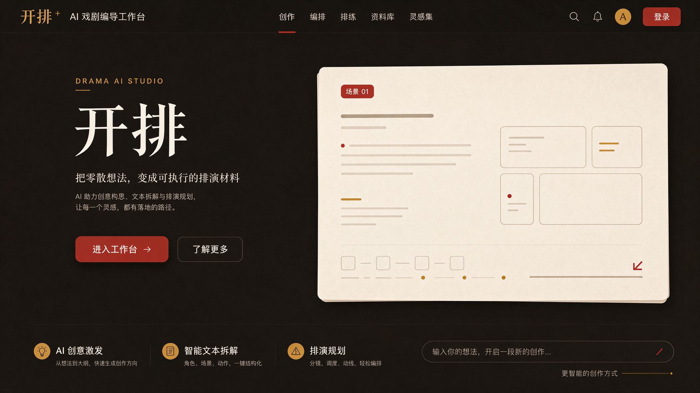

### 作品

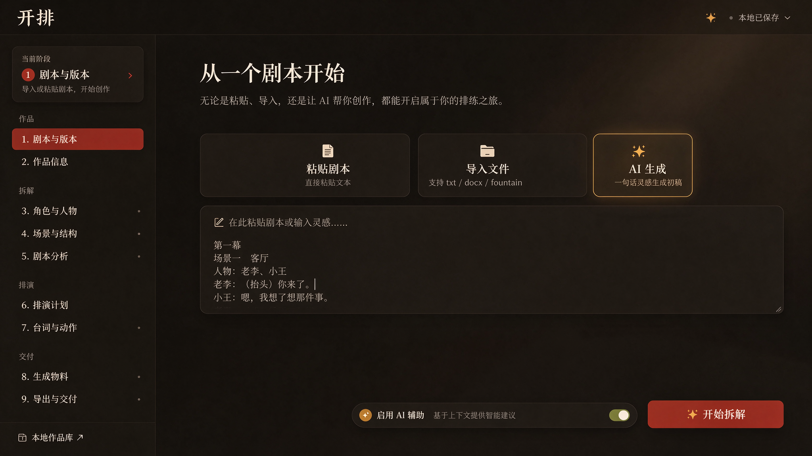

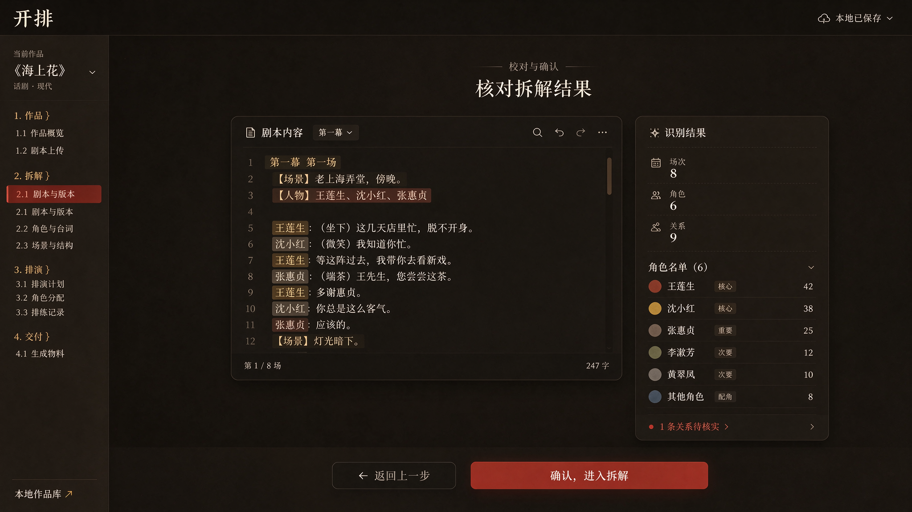

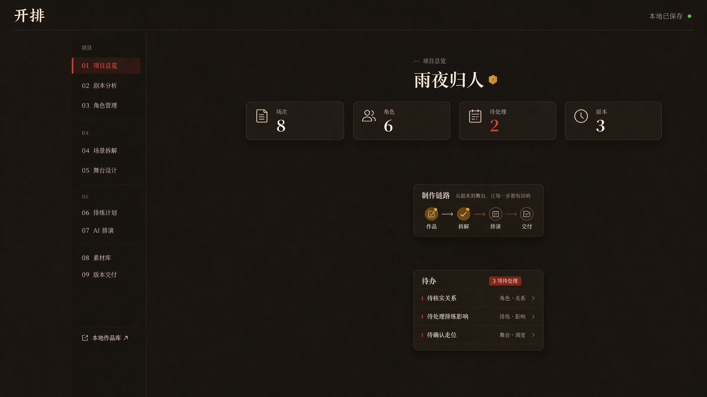

### 拆解

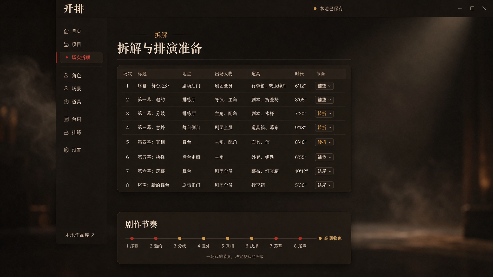

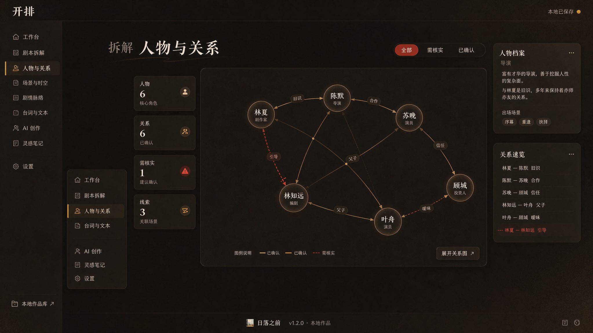

### 排演

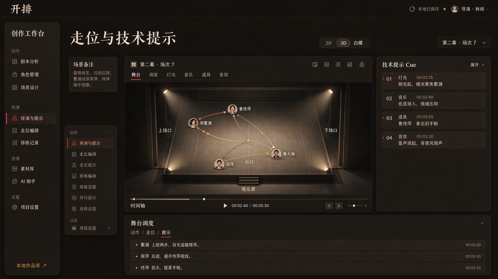

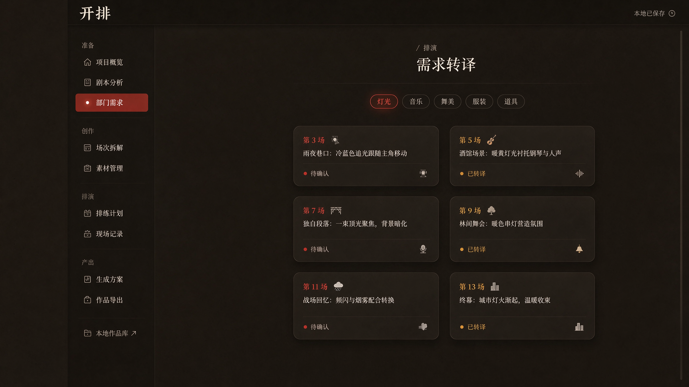

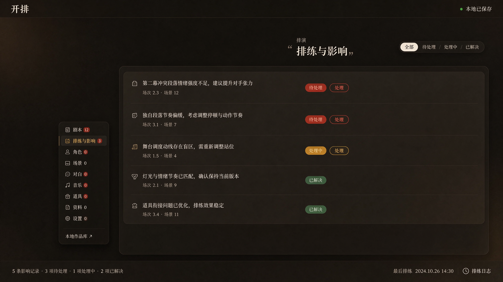

### 交付

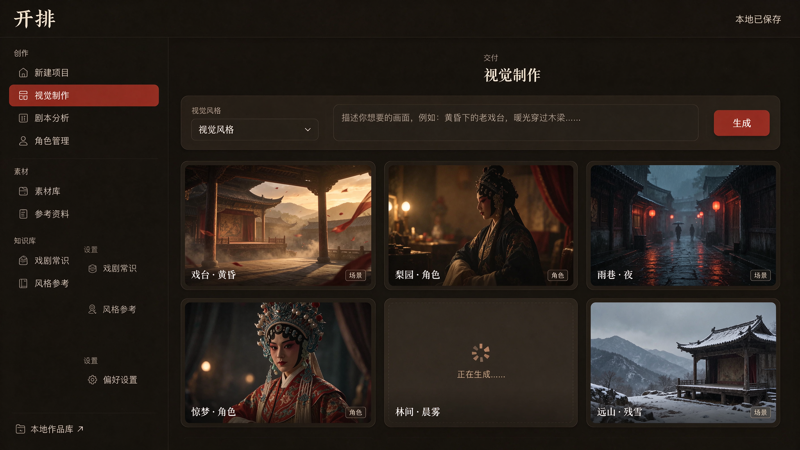

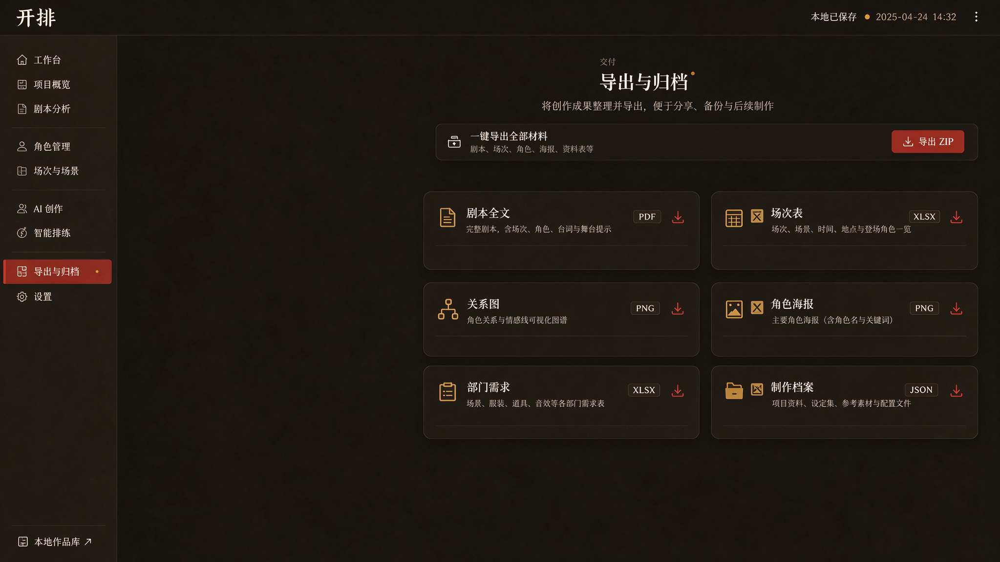

### 其他

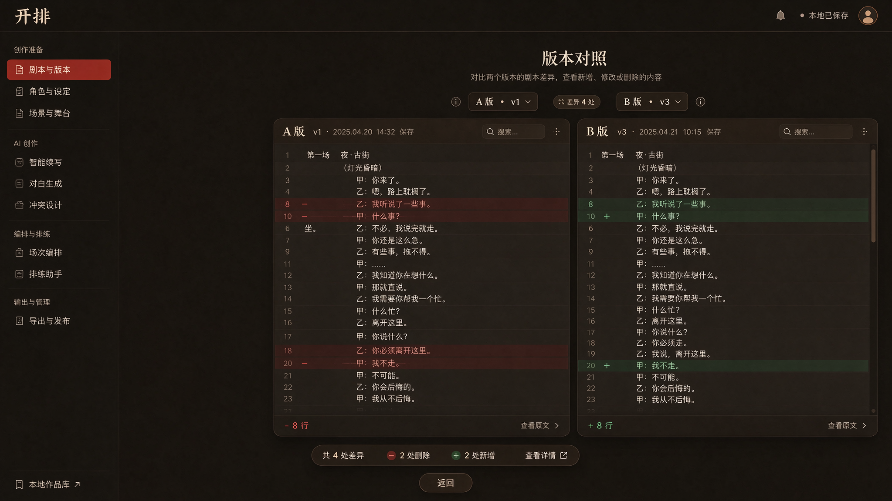


